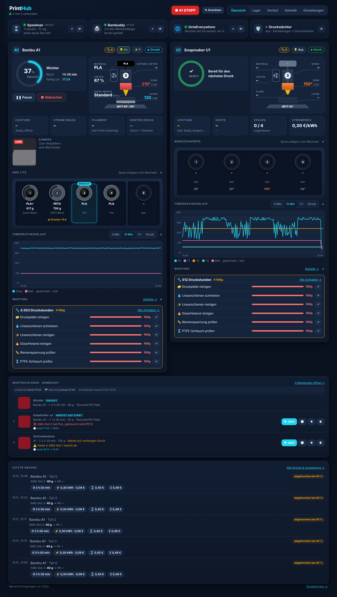
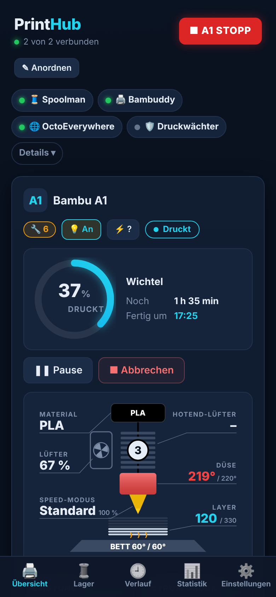
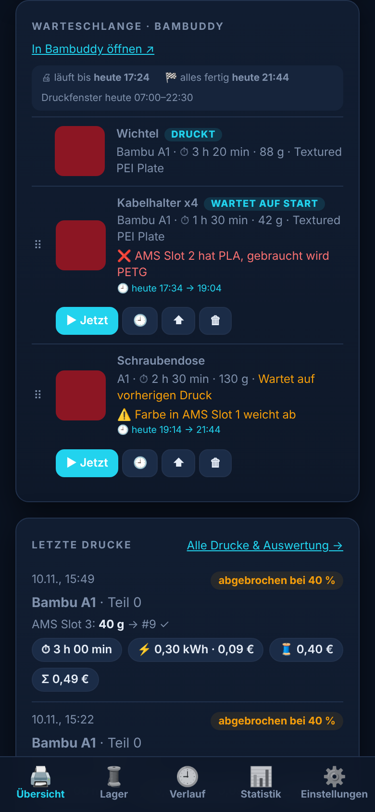
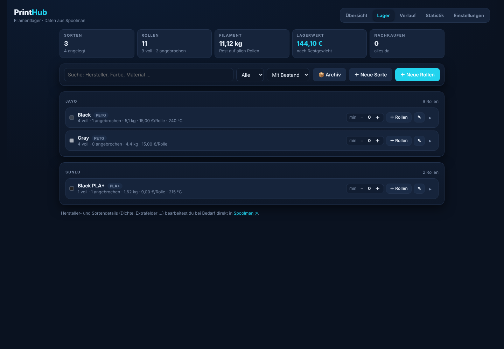
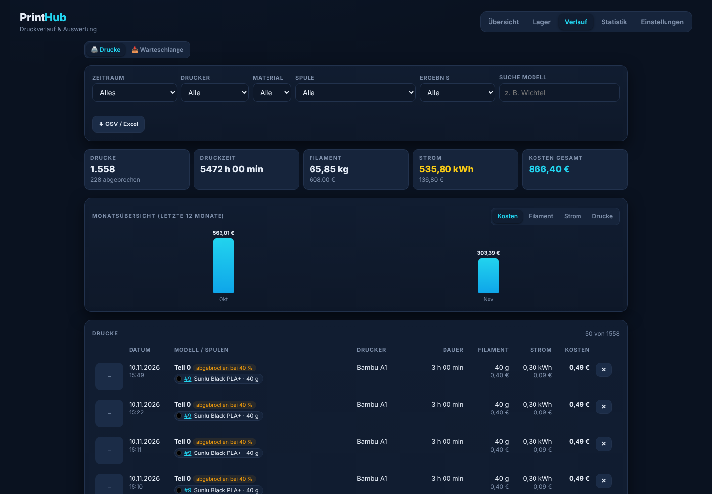
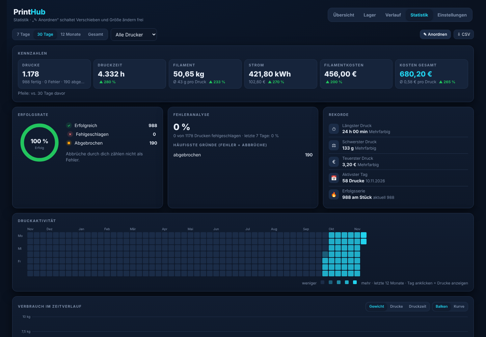
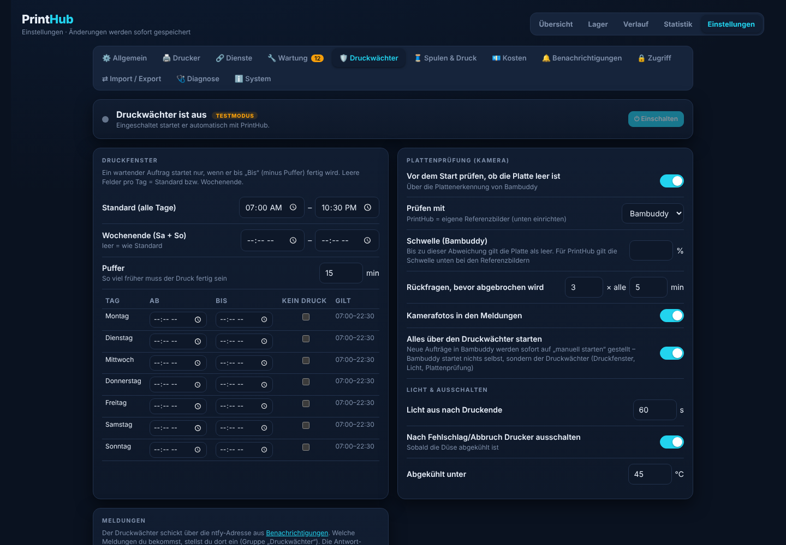
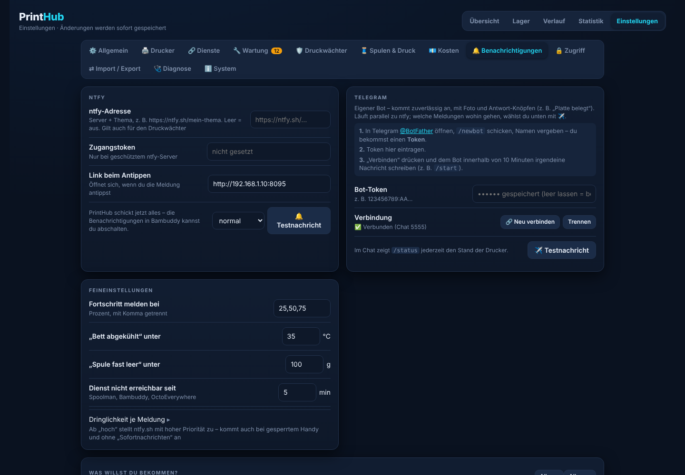
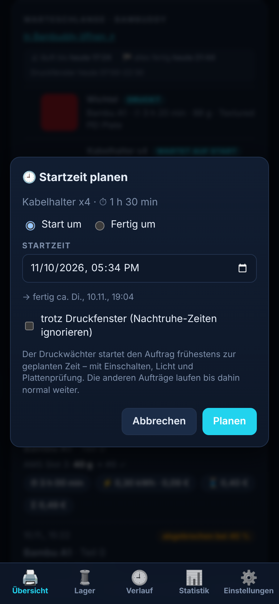

# PrintHub

**Das Cockpit für deinen 3D-Drucker – im Browser, am PC und am Handy.**

PrintHub zeigt dir auf einer Seite, was dein Drucker gerade macht, welche Spulen drin sind, was ein Druck gekostet hat
und was als Nächstes in der Warteschlange wartet. Dazu kommt der **Druckwächter**: Er startet Aufträge nur dann, wenn es
passt (Uhrzeit, leere Druckplatte, genug Filament), schaltet Licht und Strom und meldet sich per **Telegram** oder **ntfy** auf dem Handy.

Gemacht für **Bambu Lab A1 / A1 mini / P1** (über das Heimnetz, ohne Cloud) und **Klipper-Drucker mit Moonraker**
(z. B. Snapmaker U1). PrintHub läuft als Docker-Container, z. B. auf einem **Unraid**-Server, einer Synology oder einem Raspberry Pi.

<p align="center">
  
  
  
</p>

**🧪 [Live-Demo ausprobieren](https://milan941899.github.io/printhub/)** – läuft direkt im Browser, ohne Installation, mit erfundenen Daten.

> PrintHub ist ein Hobbyprojekt. Benutzung auf eigene Gefahr – ein 3D-Drucker, der nachts oder unbeaufsichtigt druckt,
> braucht trotzdem einen Rauchmelder in der Nähe.

---

## Inhalt

1. [Was kann PrintHub?](#1-was-kann-printhub)
2. [Was brauche ich?](#2-was-brauche-ich)
3. [Wie hängt alles zusammen?](#3-wie-hängt-alles-zusammen)
4. [Installation Schritt für Schritt](#4-installation-schritt-für-schritt)
5. [Die Begleiter einrichten: Spoolman, Bambuddy, virtueller Drucker, Shelly, Telegram …](#5-die-begleiter-einrichten)
6. [Alle Funktionen erklärt](#6-alle-funktionen-erklärt)
7. [Einstellungen – was bedeutet was?](#7-einstellungen--was-bedeutet-was)
8. [Typische Abläufe](#8-typische-abläufe)
9. [Probleme lösen](#9-probleme-lösen)
10. [Daten, Sicherung, Updates](#10-daten-sicherung-updates)
11. [Sicherheit](#11-sicherheit)
12. [Häufige Fragen](#12-häufige-fragen)

---

## 1. Was kann PrintHub?

| Bereich | Was du bekommst |
|---|---|
| **Übersicht** | Live-Status jedes Druckers: Fortschritt, Restzeit („noch 56 min“), Schicht, Temperaturen von Düse und Bett, Lüfter, Geschwindigkeit, Kamerabild, Licht- und Strom-Knopf, AMS-Leiste mit allen Spulen |
| **Spulen** | Jede Spule im Drucker ist einer Spule im Lager (Spoolman) zugeordnet. Nach jedem Druck wird der Verbrauch automatisch abgebucht. Warnung, wenn das Filament für den Druck nicht reicht |
| **Lager** | Bestand pro Sorte, neue Rollen anlegen (auch aus der Filament-Datenbank), Mindestbestand, Archiv, Etiketten mit QR-Code |
| **Etiketten** | QR-Etiketten für Spulen – als PDF oder direkt auf einem **Brother QL**-Etikettendrucker. QR-Code mit dem Handy scannen → Spule einem Slot zuweisen |
| **Kosten** | Pro Druck: Strom (mit Shelly-Steckdose gemessen), Filament, Verschleiß – und die Summe |
| **Verlauf** | Alle Drucke mit Modellbild und Foto nach dem Druck, Filter, Monatsübersicht, CSV-Export; dazu der Verlauf der Warteschlange |
| **Statistik** | Drucke, Erfolgsrate, Druckstunden, Filament, Strom, Kosten – pro Woche, Monat, Jahr; frei anordnenbare Kacheln |
| **Warteschlange** | Die Aufträge aus Bambuddy: starten, nach vorne holen, entfernen, per Ziehen umsortieren, **Startzeit planen**, Zeitplan-Vorschau („alles fertig morgen 12:00“), Filament-Check pro Auftrag |
| **Druckwächter** | Startet Aufträge nur im **Druckfenster** (z. B. 07:00–22:30), prüft per Kamera, ob die **Platte leer** ist, schaltet **Licht** und **Steckdose**, schaltet nach Fehlern ab |
| **Strom** | Drucker automatisch ausschalten nach dem Druck oder bei Leerlauf – aber nie, solange er druckt oder die Düse heiß ist |
| **Meldungen** | Per **Telegram** (empfohlen) oder **ntfy**: Start, fertig (mit Kosten und Foto), Fehler, Platte belegt (mit Antwort-Knöpfen), Spule fast leer, Wartung fällig … Dringlichkeit pro Meldung einstellbar |
| **Telegram-Bot** | Befehle wie `/status`, `/bild`, `/filament`, `/aufträge`, `/licht`, `/strom` – mit festen Knöpfen unten im Chat |
| **Wartung** | Wartungsbuch (z. B. Stangen schmieren alle 50 h), Meldung wenn fällig |
| **Handy** | Als App auf den Startbildschirm legen (PWA), Leiste unten wie in einer App, **Datensparmodus** im Mobilnetz |
| **Sicherheit & Pflege** | PIN-Schutz, automatische Sicherung, Diagnose mit „Alles prüfen“ und Protokoll |

### Bilder

*(Beispieldaten aus einer Testumgebung)*

| | |
|---|---|
|  **Lager** – Bestand pro Sorte, Mindestbestand, neue Rollen |  **Verlauf** – jeder Druck mit Verbrauch und Kosten |
|  **Statistik** – Kennzahlen, Rekorde, Druckaktivität |  **Druckwächter** – Druckfenster, Plattenprüfung, Licht |
|  **Meldungen** – ntfy und Telegram |  **Startzeit planen** am Handy |

---

## 2. Was brauche ich?

### Pflicht

| Was | Wozu |
|---|---|
| **Einen Rechner, der immer läuft** und Docker kann (Unraid, Synology, Raspberry Pi 4/5, Mini-PC mit Linux …) | Dort läuft PrintHub |
| **Einen 3D-Drucker im selben Heimnetz** | Bambu Lab A1 / A1 mini / P1 (siehe unten) oder ein Klipper-Drucker mit Moonraker |
| **Feste IP-Adresse für den Drucker** | Im Router einstellen („DHCP-Reservierung“), sonst findet PrintHub den Drucker nach einem Neustart nicht mehr |

**Bambu-Drucker:** PrintHub spricht direkt im Heimnetz mit dem Drucker (MQTT, Kamera, Dateien). Dafür brauchst du
am Drucker unter *Einstellungen → Netzwerk* den **LAN-Modus** und bei neueren Firmware-Versionen zusätzlich den
**Entwicklermodus** – sonst lassen Bambu-Drucker keine fremden Programme mehr zu. Du brauchst außerdem die
**Seriennummer** und den **Zugangscode** (beides steht am Druckerdisplay).

### Empfohlen (macht PrintHub erst richtig gut)

| Was | Wozu | Kosten |
|---|---|---|
| **Spoolman** | Filamentlager: jede Spule mit Restgewicht, Preis, Ort. Ohne Spoolman gibt es kein Lager, keine Filamentkosten und keine Verbrauchsbuchung | kostenlos (Docker) |
| **Bambuddy** | Warteschlange, virtueller Drucker für Bambu Studio, Druckarchiv. Ohne Bambuddy gibt es keine Warteschlange und keinen Druckwächter | kostenlos (Docker) |
| **Shelly-Steckdose** (z. B. Shelly Plug S / Plus Plug S) | Strom messen (kWh und € pro Druck) und Drucker ein-/ausschalten | ca. 20–30 € |
| **Telegram** auf dem Handy | Meldungen, die zuverlässig ankommen, Fotos, Antwort-Knöpfe | kostenlos |

### Optional

| Was | Wozu |
|---|---|
| **ntfy** | Zweiter Meldungsweg (App oder eigener Server). Auf manchen Handys (z. B. Huawei) kommen ntfy-Meldungen ohne „Sofortzustellung“ erst verspätet an – dann lieber Telegram |
| **Brother QL-Etikettendrucker** mit Netzwerk (z. B. QL-810W, QL-820NWB) | Spulen-Etiketten direkt aus PrintHub drucken |
| **OctoEverywhere** | Fernzugriff und KI-Fehlererkennung – PrintHub zeigt den Status und kann den Container bei Druckstart neu starten |
| **Eigene Kamera** (z. B. USB-Webcam über go2rtc) | Statt oder zusätzlich zur Druckerkamera |
| **Home Assistant** | Wird nicht gebraucht, stört aber auch nicht |

---

## 3. Wie hängt alles zusammen?

```
   Bambu Studio ──"Drucken"──▶  Bambuddy  (virtueller Drucker "A1 Bambuddy")
                                   │  legt den Auftrag in die Warteschlange (wartet auf Start)
                                   ▼
   PrintHub  ◀──────────────────  Druckwächter (läuft in PrintHub)
   ├─ prüft: Druckfenster? Filament reicht? Platte leer (Kamera)?
   ├─ schaltet: Steckdose an (über Bambuddy / Shelly), Licht an
   └─ startet den Auftrag über Bambuddy  ──▶  Bambu A1 druckt
                                                │
   PrintHub liest live mit (Status, Kamera)  ◀──┘
   ├─ bucht den Verbrauch in Spoolman
   ├─ rechnet Kosten (Strom vom Shelly, Filamentpreis aus Spoolman)
   ├─ macht ein Foto, schreibt den Verlauf
   └─ meldet alles per Telegram / ntfy
```

**Wer macht was?**

- **PrintHub** ist die Zentrale: Anzeige, Lager, Kosten, Meldungen und – über den **Druckwächter** – die Entscheidung, *wann* gedruckt wird.
- **Bambuddy** ist der „Motor“ im Hintergrund: Er hält die Warteschlange, nimmt Drucke aus Bambu Studio entgegen
  (virtueller Drucker) und schickt die Datei an den Drucker, wenn PrintHub „Start“ sagt.
- **Spoolman** ist das Lagerbuch für Filament.
- **Shelly** misst den Strom und schaltet die Steckdose.

Du kannst klein anfangen (nur PrintHub + Drucker) und den Rest später ergänzen.

---

## 4. Installation Schritt für Schritt

### 4.1 Unraid (am einfachsten)

1. **Vorlage holen:** Lade die Datei [`unraid/printhub.xml`](unraid/printhub.xml) herunter und lege sie auf dem
   Unraid-Stick unter `/boot/config/plugins/dockerMan/templates-user/` ab
   (z. B. über die Freigabe `flash` → `config/plugins/dockerMan/templates-user/`).
2. In Unraid: **Docker → Container hinzufügen → Vorlage: printhub** auswählen.
3. Die Vorgaben passen meistens:
   - Port **8095** (Weboberfläche)
   - `/mnt/user/appdata/printhub/config` → Konfiguration
   - `/mnt/user/appdata/printhub/data` → Verlauf, Einstellungen, Bilder
   - *Docker-Socket* (unter „Erweitert“) nur, wenn PrintHub andere Container (OctoEverywhere, Spoolman, Bambuddy) neu starten soll
   - *Zeitzone* z. B. `Europe/Berlin`, `Europe/Vienna`, `Europe/Rome`
4. **Anwenden.** Nach ein paar Sekunden: `http://<IP-deines-Servers>:8095` im Browser öffnen.
5. Weiter mit [4.3 Erster Start](#43-erster-start).

### 4.2 Docker / Docker Compose (Synology, Raspberry Pi, Linux)

Lege einen Ordner an, z. B. `printhub/`, und darin eine Datei `docker-compose.yml`:

```yaml
services:
  printhub:
    image: ghcr.io/milan941899/printhub:latest
    container_name: printhub
    restart: unless-stopped
    ports:
      - "8095:8095"
    volumes:
      - ./config:/config
      - ./data:/data
      # optional – nur wenn PrintHub andere Container neu starten soll:
      # - /var/run/docker.sock:/var/run/docker.sock
    environment:
      - TZ=Europe/Berlin
```

Dann im Ordner: `docker compose up -d`. Weboberfläche: `http://<IP>:8095`.

Ohne Compose geht es auch mit einer Zeile:

```bash
docker run -d --name printhub --restart unless-stopped -p 8095:8095 \
  -v /pfad/printhub/config:/config -v /pfad/printhub/data:/data \
  -e TZ=Europe/Berlin ghcr.io/milan941899/printhub:latest
```

### 4.3 Erster Start

1. Öffne PrintHub. Beim ersten Start ist noch kein Drucker eingetragen – PrintHub legt dafür selbst eine leere
   `config/config.yaml` an.
2. Gehe zu **Einstellungen → Drucker → ＋ Drucker hinzufügen**:
   - **Name:** frei wählbar, z. B. „Bambu A1“
   - **Typ:** *Bambu* oder *Moonraker (Klipper)*
   - **IP-Adresse** des Druckers
   - Bei Bambu: **Seriennummer** und **Zugangscode** (Drucker-Display → Einstellungen → Netzwerk/Gerät)
   - Optional: **Shelly-IP**, wenn eine Shelly-Steckdose vor dem Drucker steckt
   - Optional: **Kamera-Adresse**, falls du eine eigene Kamera nutzt
3. **🔌 Verbindung testen** → **💾 Speichern & PrintHub neu starten**.
4. Zurück auf der **Übersicht** siehst du nach ein paar Sekunden den Drucker live.
5. Danach unter **Einstellungen → Dienste** Spoolman und Bambuddy eintragen (Kapitel 5).
6. **Einstellungen → Diagnose → Alles prüfen** zeigt dir, ob alles verbunden ist – mit verständlichen Hinweisen, falls nicht.

> Wer lieber mit Dateien arbeitet: Die Drucker stehen in `config/config.yaml`. Eine kommentierte Vorlage ist
> [`config.example.yaml`](config.example.yaml). Zugangscodes stehen **nur** in dieser Datei auf deinem Server.

### 4.4 Am Handy als App

Öffne PrintHub im Handy-Browser (Chrome, Vivaldi, Samsung Internet, Safari) → Menü → **„Zum Startbildschirm hinzufügen“**
bzw. **„App installieren“**. PrintHub startet dann ohne Adressleiste, mit Navigationsleiste unten wie eine App.

---

## 5. Die Begleiter einrichten

### 5.1 Spoolman (Filamentlager)

**Was ist das?** Ein kleines Programm, in dem jede Filamentrolle mit Hersteller, Material, Farbe, Preis und
Restgewicht steht. PrintHub liest und bucht dort.

**Installieren (Unraid):** *Apps* (Community Applications) → „Spoolman“ suchen → installieren. Standard-Port **7912**.
Andere Systeme: siehe [Spoolman auf GitHub](https://github.com/Donkie/Spoolman).

**In PrintHub verbinden:** *Einstellungen → Dienste → Spoolman → Adresse*, z. B. `http://192.168.1.10:7912`.

**Erste Schritte:**
1. Im **Lager** von PrintHub → **＋ Neue Sorte**: Hersteller wählen und in der **Filament-Datenbank (SpoolmanDB)**
   suchen, z. B. „Bambu PLA Basic Black“ – Dichte, Durchmesser und Farbe werden übernommen. Preis pro Rolle eintragen.
2. **＋ Neue Rollen**: Sorte, Anzahl, Ort (z. B. „Regal“) – auf Wunsch gleich Etiketten drucken.
3. Auf der **Übersicht** beim Drucker auf einen AMS-Slot tippen → die passende Spule auswählen. Ab jetzt wird nach jedem
   Druck automatisch abgebucht.

### 5.2 Bambuddy (Warteschlange & „Motor“)

**Was ist das?** Ein kostenloses Programm für Bambu-Drucker im Heimnetz: Druckarchiv, Warteschlange, Steckdosen-Steuerung
und ein **virtueller Drucker**, an den Bambu Studio seine Drucke schickt.

**Installieren (Unraid):** *Apps* → „Bambuddy“ → installieren. Standard-Port **8000**.
Andere Systeme und Anleitung: [Bambuddy-Wiki](https://wiki.bambuddy.cool).

**In Bambuddy:**
1. Deinen Drucker hinzufügen (IP, Seriennummer, Zugangscode).
2. Falls du in Bambuddy die Anmeldung eingeschaltet hast: *Einstellungen → API-Schlüssel* → neuen Schlüssel anlegen mit den
   Rechten **Status lesen**, **Warteschlange**, **Smart Plugs** und **Kamera**.

**In PrintHub:** *Einstellungen → Dienste → Bambuddy* → Adresse (z. B. `http://192.168.1.10:8000`) und – falls nötig – API-Schlüssel.
Der Druckwächter bekommt Adresse und Schlüssel unter *Einstellungen → Druckwächter*.

### 5.3 Virtueller Drucker (Drucken aus Bambu Studio über die Warteschlange)

Damit **jeder** Druck durch den Druckwächter läuft (Druckfenster, Plattenprüfung, Licht), schickst du aus Bambu Studio
nicht direkt an den Drucker, sondern an den **virtuellen Drucker** von Bambuddy.

1. Bambuddy → **Virtuelle Drucker → ＋ Hinzufügen**, z. B. „A1 Bambuddy“, Modell wie dein echter Drucker.
2. **Modus: „Warteschlange“** (Archivieren und zur Warteschlange hinzufügen).
3. **„Automatisch starten“: AUS.** Dann wartet jeder Auftrag, bis der Druckwächter ihn startet.
4. In Bambu Studio erscheint der virtuelle Drucker wie ein normaler Drucker im Netz. Ab jetzt immer **dorthin** senden.

> Sicherheitsnetz: In PrintHub unter *Einstellungen → Druckwächter* ist **„Alles über den Druckwächter starten“** standardmäßig an.
> Taucht trotzdem ein Auftrag auf, den Bambuddy selbst starten würde, stellt der Druckwächter ihn innerhalb von Sekunden auf
> „manuell starten“ um.
>
> Ein Druck, den Bambu Studio **direkt** an den echten Drucker schickt, geht an der Warteschlange vorbei – den kann niemand
> vorher prüfen.

### 5.4 Shelly-Steckdose (Strom messen & schalten)

1. Shelly mit der **Shelly-App** ins WLAN bringen und im Router eine **feste IP** vergeben.
2. Drucker an die Shelly-Steckdose anschließen.
3. **Strom messen:** In PrintHub bei deinem Drucker (*Einstellungen → Drucker*) die **Shelly-IP** eintragen.
   PrintHub misst dann die kWh pro Druck; den **Strompreis** stellst du unter *Einstellungen → Kosten* ein.
4. **Schalten (empfohlen über Bambuddy):** In Bambuddy unter *Einstellungen → Smart Plugs* die Steckdose anlegen
   (Typ Shelly/REST, IP), dem Drucker zuordnen und **„Versorgt den Drucker“** einschalten.
   - **„Auto Ein“**: an lassen – Bambuddy/der Druckwächter schaltet vor dem Start ein.
   - **„Auto Aus“**: **aus**, wenn PrintHub die Strom-Verwaltung übernimmt (siehe 6.10) – sonst schalten zwei Programme.
5. In PrintHub *Einstellungen → Drucker → ⚡ Strom-Verwaltung* sieht man, ob die Steckdose gefunden wurde.

PrintHub schaltet bevorzugt **über Bambuddy** (damit Bambuddy weiß, dass der Drucker aus ist) und nimmt die Shelly direkt
nur als Rückfallweg.

### 5.5 Telegram (Meldungen aufs Handy – empfohlen)

1. Telegram öffnen → den Kontakt **@BotFather** suchen → `/newbot` → Namen und Benutzernamen vergeben
   (muss auf `bot` enden, z. B. `meindrucker_bot`).
2. BotFather schickt dir einen **Token** (sieht aus wie `123456789:AAH…`). Diesen nicht weitergeben.
3. PrintHub → *Einstellungen → Meldungen → Telegram* → **Bot-Token** einfügen → **Verbinden**.
4. Deinem neuen Bot in Telegram **/start** schicken. PrintHub koppelt sich mit deinem Chat und schickt eine Testnachricht.
5. Fertig. Im Chat erscheinen unten feste Knöpfe (Status, Bild, Filament, Aufträge …), die Hilfe wird oben angepinnt.

Bei *Was willst du bekommen?* stellst du pro Meldung ein, ob sie per ntfy, Telegram (✈️) oder beides kommt.

**Befehle im Bot:**

| Befehl | Was passiert |
|---|---|
| `/status` | Stand aller Drucker (Fortschritt, Restzeit, Warteschlange) |
| `/bild` | Aktuelles Kamerabild |
| `/filament` | Spulen im Drucker und Lagerbestand |
| `/aufträge` (`/warteschlange`) | Warteschlange mit geplanten Zeiten und Knöpfen ▶ Jetzt · ⬆ Vor · 🗑 Raus |
| `/verlauf` | Die letzten 5 Drucke |
| `/statistik` | Drucke, Filament, Kosten – `/statistik woche`, `jahr`, `gesamt` |
| `/wartung` | Fällige Wartungen |
| `/licht` | Licht an/aus |
| `/strom` | Drucker ein-/ausschalten (mit Sicherheitsabfrage) |
| `/platte` | Plattenprüfung jetzt machen und Ergebnis mit Foto schicken |
| `/hilfe` | Alle Befehle und die Knöpfe |

### 5.6 ntfy (zweiter Meldungsweg, optional)

1. ntfy-App installieren (Android/iOS) oder einen eigenen ntfy-Server betreiben.
2. In der App ein **Thema** abonnieren, z. B. `drucker-meinname-7x2k` (lang und schwer zu erraten wählen – auf ntfy.sh kann jeder,
   der das Thema kennt, mitlesen).
3. PrintHub → *Einstellungen → Meldungen → ntfy-Adresse*: `https://ntfy.sh/drucker-meinname-7x2k` (bzw. dein Server).
   Zugangstoken nur, wenn dein Server eine Anmeldung verlangt.
4. Auf Android in der ntfy-App **„Sofortzustellung“** einschalten und Akku-Optimierung für ntfy ausschalten, sonst kommen Meldungen verspätet.

Die **Dringlichkeit** (normal / hoch / dringend) stellst du je Meldung unter *Meldungen → Feineinstellungen* ein.

### 5.7 Brother QL-Etikettendrucker (optional)

1. Etikettendrucker ins Netzwerk bringen, feste IP vergeben.
2. PrintHub → *Einstellungen → Spulen → Etikettendrucker (Brother QL)*: **IP-Adresse**, **Modell** und **Etikett**
   (z. B. DK-22205 62 mm Endlos, Länge einstellbar) eintragen → **Vorschau** prüfen.
3. Im **Lager** bei einer Spule bzw. auf der Seite **Etiketten** → **Drucken**. Ohne Etikettendrucker bekommst du ein PDF.

Damit der QR-Code am Handy funktioniert, unter *Einstellungen → Spulen → Adresse für QR-Codes & NFC* die Adresse eintragen,
unter der dein Handy PrintHub erreicht (z. B. `http://192.168.1.10:8095`).

### 5.8 OctoEverywhere (optional)

Unter *Einstellungen → Dienste → OctoEverywhere* einen Link eintragen (erscheint dann als Knopf) und den Container-Namen.
Mit **„Bei Druckstart neu starten“** startet PrintHub den OctoEverywhere-Container kurz nach jedem Druckstart neu
(hilft, wenn die Kamera dort hängen bleibt). Dafür braucht PrintHub den Docker-Socket.

### 5.9 Snapmaker U1 / Klipper (Moonraker)

Drucker mit Typ **Moonraker** anlegen, IP und Port (Standard **7125**) eintragen, Anzahl Kanäle (z. B. 4 beim U1).
Wenn dein Drucker den Filamentverbrauch schon selbst an Spoolman bucht (z. B. über Moonraker-Spoolman), bei
**Verbrauch buchen** ausschalten – sonst wird doppelt gebucht. Die Warteschlange und der Druckwächter sind
(noch) nur für Bambu-Drucker über Bambuddy gedacht.

---

## 6. Alle Funktionen erklärt

### 6.1 Übersicht

- **Druckerkarte:** Zustand (bereit, druckt, pausiert, Fehler), Fortschrittsring, Restzeit und Fertig-Uhrzeit, Schicht x/y,
  Düse und Bett mit Ziel-Temperatur, Lüfter, Geschwindigkeitsstufe, Dateiname und Modellbild.
- **Kamera:** Live-Bild der Druckerkamera (oder eigener Kamera), antippen zum Vergrößern.
- **💡 Licht** und **⚡ Strom**-Knopf direkt an der Karte.
- **AMS-Leiste:** Jeder Slot mit Farbe, Material und zugeordneter Spule aus dem Lager inkl. Restgewicht.
  Slot antippen → Spule wählen oder aus dem Drucker nehmen.
- **Arbeitsschritt:** Was der Drucker gerade macht – z. B. „🔥 Düse heizt · 111 / 220 °C“, „📐 Bett wird vermessen“,
  „🧽 Düse wird gereinigt“, „⏸ Pausiert: Filament leer“. Darunter aufklappbar der **Ablauf** mit Dauer je Schritt.
  Das Schild oben rechts und der Browser-Tab zeigen den Schritt ebenfalls (z. B. „🔥 Heizt“), `/status` in Telegram auch.
  Der Ablauf übersteht Neustarts und Updates und steht nach dem Druck im **Verlauf** („⚙ Vorb. 5:20“ zum Aufklappen).
  (Bambu-Drucker; bei Klipper nur „heizt“ und die Display-Meldung.)
- **Filament leer, keine gleiche Rolle im AMS:** Der Drucker pausiert. PrintHub zeigt (und schickt per Telegram) Knöpfe
  mit den Slots, die dasselbe Material haben – antippen lädt diesen Slot und setzt den Druck automatisch fort.
  Ab dieser Schicht hat das Teil dann die andere Farbe. Bei mehrfarbigen Drucken nur eingeschränkt sinnvoll.
- **Dienste-Chips:** Grün/Rot für Spoolman, Bambuddy, OctoEverywhere, Druckwächter – antippen für Details und Neustart.
- **Warteschlange** und **Letzte Drucke** (siehe unten).
- **✎ Anordnen:** Kacheln verschieben und in der Größe ändern; wird pro Gerät gespeichert.
- **Im Browser-Tab** siehst du den Fortschritt im Titel und als Ring im Symbol – auch wenn der Tab im Hintergrund ist.

### 6.2 Spulen & Verbrauch

- Nach jedem Druck bucht PrintHub den Verbrauch **pro Slot** auf die zugeordnete Spule in Spoolman.
- Hat der Drucker während des Drucks automatisch auf eine andere Spule gewechselt (AMS-Nachfüllen), wird der Verbrauch aufgeteilt.
- **„Filament reicht nicht“**: Beim Druckstart vergleicht PrintHub den geplanten Bedarf mit dem Rest der Spule
  (plus einstellbarer Sicherheitsreserve) und warnt.
- **„Spule fast leer“** unter einer einstellbaren Grenze.
- **Spule leer gelaufen:** Wechselt das AMS mitten im Druck auf eine gleiche Rolle (oder pausiert wegen Filamentende),
  weiß PrintHub, dass die alte Spule wirklich leer ist. Nach dem Druck vergleicht es mit dem Lager und schlägt bei
  größerer Abweichung (einstellbar, Standard 15 g) vor, das Leergewicht der Spule zu wiegen.
- **Slot am Drucker einstellen:** Beim Zuweisen schickt PrintHub Material, Farbe und Profil an den Drucker – Bambu Studio sieht es dann auch.
- **Gelernte Bambu-Profile:** PrintHub merkt sich, welches Bambu-Filamentprofil zu welcher Sorte gehört.

### 6.3 Lager

- Bestand pro **Sorte** (Hersteller + Material + Farbe) mit Anzahl Rollen, Gesamtgewicht, Wert.
- **Mindestbestand** pro Sorte → Meldung „Lagerbestand unter Minimum“.
- Neue Sorten aus der **SpoolmanDB** (Tausende Filamente mit korrekten Daten) übernehmen.
- **⚖ Wiegen:** Bruttogewicht von der Waage eingeben – PrintHub zieht das Leergewicht der Spule ab und speichert den
  Rest. Das Leergewicht merkt sich PrintHub auf Wunsch für die ganze Sorte. In der Liste steht bei jeder Rolle, was die
  Waage zeigen sollte („⚖ 1165 g“) – so sieht man Abweichungen sofort.
- **Viele ähnliche Sorten bequem anlegen:**
  - Bei „Neue Sorte“ übernimmt PrintHub automatisch Preis, Temperaturen, Netto- und Leergewicht der zuletzt angelegten Sorte
    desselben Herstellers und Materials – nur Name und Farbe eintragen. **⧉** an jeder Sorte macht dasselbe gezielt.
  - **⋯ Mehr → 🎨 Mehrere Farben anlegen:** gemeinsame Werte einmal, dann pro Farbe eine Zeile (Name, Farbe, Anzahl Rollen) –
    oder Farben direkt aus der Filament-Datenbank ankreuzen.
  - **☑ Sorten auswählen → ✎ Gemeinsam bearbeiten:** Preis, Temperaturen, Gewichte für viele Sorten auf einmal ändern.
  - **Farbe zum Namen:** PrintHub sucht zu „Sky Blue“ & Co. den Farbwert – zuerst in der Filament-Datenbank (gleicher Hersteller),
    sonst in einer eingebauten Farbliste. Passt nichts, gibt es **📷 aus Foto** (Pipette, mit Weißabgleich am Etikett).
  - **Namen:** Sorten heißen wie auf dem Etikett (meist Englisch). **⋯ Mehr → Aa Namen vereinheitlichen** benennt deutsche
    Farbnamen um („Weiß“ → „White“). Suche und Abgleich verstehen beide Sprachen.
  - Leergewicht beim Wiegen auch **für alle Rollen eines Herstellers** merken.
- **📷 Rolle scannen:** Etikett oder Schachtel mit dem Handy fotografieren. PrintHub liest den Strichcode (EAN oder
  Chargen-Nummer) und den Text auf dem Etikett (Material, Farbe, Gewicht, Temperaturen) und schlägt die passende Sorte vor –
  oder legt mit diesen Daten eine neue an. Codes werden gelernt: ab der zweiten Rolle reicht ein Scan. Unbekannte EAN-Codes
  schlägt PrintHub online nach (UPCitemdb, kostenlos, 100 Abfragen/Tag). Die Chargen-Nummer wird bei der Rolle gespeichert.
  Live-Scannen mit der Kamera geht, wenn PrintHub über HTTPS aufgerufen wird (z. B. Tailscale Serve); sonst per Foto.
- **Neue Rollen brutto gewogen anlegen:** zeigt gleich, ob wirklich 1000 g drauf sind („994 g – −6 g zum Nenngewicht“).
- **✎ Rolle bearbeiten:** Filament neu, übrig, Leergewicht, Preis, Ort, Charge, Notiz – ohne Spoolman öffnen zu müssen.
- **💧 Trocknen:** Jede angebrochene Rolle zeigt, wie viele Tage sie offen ist (seit dem Öffnen bzw. dem letzten Trocknen).
  Nach dem Trocknen (z. B. im Filamenttrockner) auf **🔥** tippen. Grenzen pro Material einstellbar (Standard: PLA 60,
  PETG 21, TPU 7, PA 3 Tage …). Steckt eine zu lange offene Rolle im Drucker, kommt eine Meldung mit Knopf „getrocknet“.
- Leere Spulen ins **Archiv** (📦 an jeder Rolle, auch wenn sie noch einem Slot zugeordnet ist).
- **Etiketten** einzeln oder für mehrere Spulen auf einmal.

### 6.4 Spule per QR-Code zuweisen

Etikett auf die Spule kleben. Wenn du die Spule in den Drucker legst: QR-Code mit dem Handy scannen → PrintHub öffnet
„Spule zuweisen“ → Slot antippen → fertig.

### 6.5 Kosten

Pro Druck rechnet PrintHub:
- **Strom:** gemessene kWh × Strompreis (braucht Shelly)
- **Filament:** verbrauchte Gramm × Preis pro Gramm der Spule (aus Spoolman; Ersatzpreis einstellbar)
- **Verschleiß:** Betrag pro Druckstunde (Düse, Platte, Riemen …)
- **Σ Summe** – erscheint im Verlauf, in der Statistik und in der „Druck fertig“-Meldung.

### 6.6 Verlauf

- **Drucke:** jeder Druck mit Zeit, Drucker, Datei, Ergebnis (fertig / abgebrochen bei x % / Fehler), Verbrauch pro Slot,
  Kosten, Modellbild und **Foto nach dem Druck** (antippen zum Vergrößern). Filter, Suche, Monatsübersicht, **CSV-Export**.
- **↻ Nochmal drucken:** legt einen Druck aus dem Verlauf wieder in die Bambuddy-Warteschlange (sucht dazu die Datei im
  Bambuddy-Archiv). Gestartet wird wie immer über den Druckwächter. Auch per Telegram unter `/verlauf`.
- **Warteschlange:** Was mit deinen Aufträgen passiert ist – aus Bambuddy (fertig, abgebrochen), vom Druckwächter
  (übernommen, wartet, Platte belegt, gestartet) und aus PrintHub (geplant, nach vorne geholt, entfernt). Filter nach Quelle.

### 6.7 Statistik

Kacheln für Drucke, Erfolgsrate, Druckzeit, Filament nach Material/Farbe, Strom, Kosten, Drucke pro Tag/Uhrzeit –
für Woche, Monat, Jahr oder gesamt. Mit **✎ Anordnen** frei verschieben. Ältere Drucke lassen sich aus Bambuddy übernehmen.

### 6.8 Warteschlange (braucht Bambuddy)

Auf der Übersicht siehst du alle Aufträge aus Bambuddy:

- **Zeitplan oben:** „🖨 läuft bis heute 16:46 · 🏁 alles fertig morgen 12:00 · Druckfenster heute 07:00–22:30“.
- Pro Auftrag: Name, Bild, Dauer, Gramm, Platte, **voraussichtliche Druckzeit** („🕘 heute 16:57 → 18:27“).
- **Filament-Check:** ✅ passt · ⚠️ Farbe weicht ab / keine Spule zugeordnet · ❌ falsches Material oder Spule reicht nicht.
  Kommt ein Auftrag mit Problem in die Warteschlange, gibt es eine Meldung.
- **▶ Jetzt:** startet sofort über den Druckwächter (Einschalten, Licht, Plattenprüfung) – auch außerhalb des Druckfensters.
- **🕘 Planen:** „Start um 06:30“ oder „Fertig um 17:00“ (PrintHub rechnet den Start aus). Liegt das außerhalb des
  Druckfensters, fragt PrintHub nach – oder du hakst **„trotz Druckfenster“** an. „Planung entfernen“ nimmt die Zeit wieder raus.
- **⬆** nach vorne holen, **🗑** entfernen, **⠿** ziehen zum Umsortieren.

### 6.9 Druckwächter

Der Druckwächter läuft in PrintHub mit (*Einstellungen → Druckwächter*, dort einschalten). Er arbeitet die Warteschlange ab:

1. **Druckfenster:** Ein Auftrag startet nur, wenn er **im Fenster fertig wird** (inkl. Puffer).
   Beispiel: Fenster 07:00–22:30, Puffer 15 min, Druck 3 h → letzter Start 19:15.
   Eigene Zeiten pro Wochentag oder fürs Wochenende, oder „aus“ (an dem Tag gar nicht drucken).
   Passt ein Auftrag heute nicht mehr, wartet er bis morgen – die **Reihenfolge bleibt**.
   Ein Auftrag, der länger dauert als jedes Druckfenster, wartet auf deine Freigabe (Knopf „Jetzt starten“ in der Meldung).
2. **Geplante Aufträge** starten nicht vor ihrer Zeit; die anderen dürfen bis dahin drucken.
3. **Einschalten:** Steckdose an, warten bis der Drucker online ist, **Licht an**.
4. **Plattenprüfung:** Foto von der Platte → leer? Dann Start. Belegt? Meldung mit Foto und Knöpfen
   **„Platte ist leer – starten“** / **„Abbrechen“**; ohne Antwort fragt er mehrmals nach und bricht dann ab.
5. **Start** über Bambuddy.
6. **Nach dem Druck:** Licht aus nach x Sekunden; nach Fehlschlag/Abbruch Drucker ausschalten, sobald die Düse abgekühlt ist.
7. Überwacht den Druck: Fehler (HMS), Pausen, Drucker offline → Meldung.

**Testmodus:** Der Druckwächter schreibt nur ins Protokoll, was er tun würde, schaltet und startet aber nichts.
Zum Ausprobieren ideal – danach ausschalten.

### 6.10 Plattenerkennung in PrintHub

Die Kamera vergleicht die Platte mit **Referenzbildern der leeren Platte**:

1. *Einstellungen → Druckwächter → Plattenerkennung in PrintHub*.
2. Platte leer machen, Licht an → **Referenzbild aufnehmen**. Am besten mehrere: Schranktür offen und zu, Tag und Abend,
   jede Druckplatte. Optional mit Beschriftung wie „PEI texturiert“ – passt sie zur Platte des Auftrags, werden nur diese Bilder genutzt.
3. **Prüfbereich** im Bild aufziehen (nur die Platte, ohne Rand).
4. **Schwelle** einstellen und mit **„Jetzt prüfen“** testen – einmal mit leerer Platte, einmal mit einem Teil drauf.
5. Bei **„Prüfen mit“** auf **PrintHub** stellen.

PrintHub sucht die größte zusammenhängende Abweichung und blendet Spiegelungen aus – so schlagen Lichtreflexe nicht an,
ein kleines Teil aber schon.

### 6.11 Strom-Verwaltung

*Einstellungen → Drucker → ⚡ Strom-Verwaltung* → **Automatisch ausschalten**:

- **Nach dem Druck:** x Minuten nach Druckende aus.
- **Leerlauf:** x Minuten ohne Druck aus.
- **Erst aus unter:** nur wenn die Düse kühler ist als x °C (Standard 45 °C).
- **Nie** während eines Drucks, einer Pause, wenn der Druckwächter gerade startet oder ein Auftrag sofort drankommt.
- Meldung „Drucker ausgeschaltet“.

Wenn PrintHub das übernimmt, in Bambuddy bei der Steckdose **„Auto Aus“ ausschalten** (PrintHub zeigt den Hinweis an).

### 6.12 Meldungen

| Meldung | Bedeutung |
|---|---|
| Druck gestartet / erste Schicht fertig / Fortschritt | mit Foto, Fortschritt in einstellbaren Schritten |
| Druck fertig | mit Dauer, Verbrauch, **Kosten** und Foto |
| Abgebrochen / fehlgeschlagen / pausiert / Druckerfehler | sofort, mit Foto |
| Bett abgekühlt | jetzt kann das Teil runter |
| Drucker während eines Drucks offline | z. B. WLAN weg |
| Auftrag wartet aufs Druckfenster | mit Knopf „Jetzt starten“ |
| Platte belegt | mit Foto und Antwort-Knöpfen |
| Drucker ausgeschaltet | von der Strom-Verwaltung |
| Spule fast leer / Filament reicht nicht / Lager unter Minimum | |
| Spule leer gelaufen | Vergleicht mit dem Lager: passt es, Knopf „Auf 0 & archivieren“; weicht es ab, Hinweis „Leergewicht prüfen“ mit Link zum Wiegen |
| Wartung fällig | |
| Dienst nicht erreichbar | Spoolman, Bambuddy oder OctoEverywhere antwortet nicht |
| Neuer Auftrag / Warteschlange abgearbeitet / Auftrag mit Filament-Problem | |

Jede Meldung einzeln ein/aus, getrennt für ntfy und Telegram, mit eigener Dringlichkeit.

### 6.13 Wartung

*Einstellungen → Wartung*: Aufgaben mit Intervall in Druckstunden oder Tagen (z. B. „Platte reinigen alle 25 h“,
„Trockenmittel wechseln alle 30 Tage“) – oder nach **Anzahl Drucke** (z. B. „Druckplatte waschen alle 20 Drucke“). **Erledigt** antippen setzt den Zähler zurück. Fällige Wartungen erscheinen auf der
Übersicht, per Meldung und mit `/wartung`. Vorhandene Wartungsdaten aus Bambuddy werden mit angezeigt.

### 6.14 Handy & Datensparen

- Navigationsleiste unten wie in einer App; beim Hineinzoomen blendet sie sich aus.
- **Datensparmodus** (*Einstellungen → Allgemein*, pro Gerät): *Automatisch* (im Mobilnetz sparen), *Immer* oder *Aus*.
  Im Hintergrund pausiert PrintHub komplett; die Kamera lädt nur, wenn sie sichtbar ist.

### 6.15 Diagnose

*Einstellungen → Diagnose → Alles prüfen*: prüft Drucker, Kamera, Spoolman, Bambuddy, Druckwächter, Strom-Verwaltung,
Telegram, ntfy, Etikettendrucker, Speicherplatz – und sagt in normaler Sprache, was zu tun ist.
Darunter das **Protokoll** (Passwörter und Tokens werden darin unkenntlich gemacht) zum Kopieren, falls du Hilfe brauchst.

---

## 7. Einstellungen – was bedeutet was?

| Reiter | Inhalt |
|---|---|
| **Allgemein** | Theme (hell/dunkel/automatisch), Datensparmodus, Fortschritt im Browser-Tab, welche Bereiche die Übersicht zeigt |
| **Drucker** | Drucker anlegen/ändern/testen, Strom-Verwaltung |
| **Dienste** | Adressen von Spoolman, Bambuddy, OctoEverywhere; Container-Namen für Status und Neustart |
| **Wartung** | Wartungsbuch |
| **Druckwächter** | Ein/aus, Bambuddy-Zugang, Druckfenster pro Tag, Puffer, Plattenprüfung, Referenzbilder, „Alles über den Druckwächter“, Licht, Ausschalten nach Fehler, Testmodus, Protokoll |
| **Spulen** | Slot am Drucker setzen, Standort im Regal, „fast leer“-Grenze, QR-Adresse, Filament-Warnung + Reserve, Foto nach dem Druck, Etikettendrucker, gelernte Profile |
| **Kosten** | Strompreis (€/kWh), Verschleiß (€/h), Ersatz-Filamentpreis |
| **Meldungen** | ntfy, Telegram, Feineinstellungen (Fortschritt alle x %, Grenzen), Dringlichkeit, welche Meldung über welchen Weg |
| **Zugriff** | PIN-Schutz |
| **Daten** | Sicherung herunterladen/zurückspielen, automatische Sicherung, Export (Verlauf, Statistik, Wartung), Import aus Bambuddy |
| **Diagnose** | Alles prüfen, Protokoll |
| **System** | Version, Docker-Zugriff, Neustart |

Die meisten Einstellungen werden **sofort gespeichert**. Nur Änderungen an Druckern brauchen einen Neustart von PrintHub
(der Knopf „Speichern & neu starten“ erledigt das in ein paar Sekunden).

---

## 8. Typische Abläufe

**Abends etwas für morgen früh vorbereiten**
1. In Bambu Studio slicen → an „A1 Bambuddy“ senden.
2. Der Auftrag erscheint in PrintHub. Passt er heute nicht mehr ins Druckfenster, steht dort z. B. „🕘 morgen 07:00 → 10:10“.
3. Morgens um 07:00 schaltet der Druckwächter ein, prüft die Platte und startet. Du bekommst „Druck gestartet“ mit Foto.

**Soll um 17:00 fertig sein, wenn ich heimkomme**
Auftrag → 🕘 → „Fertig um“ 17:00 → Planen.

**Mehrere Teile hintereinander**
Alle in die Warteschlange legen. Nach jedem Druck kommt „Druck fertig“ – Teil abnehmen. Der Druckwächter prüft vor dem
nächsten Start, ob die Platte leer ist, und fragt sonst per Telegram nach.

**Neue Spule einlegen**
Spule ins AMS → QR-Etikett scannen → Slot wählen. Ohne Etikett: Übersicht → Slot antippen → Spule wählen.

**Unterwegs nachsehen**
Telegram → `/status` oder `/bild`. Für die volle Oberfläche von unterwegs z. B. ein VPN wie Tailscale oder WireGuard nutzen.

---

## 9. Probleme lösen

Zuerst immer: **Einstellungen → Diagnose → Alles prüfen.**

| Problem | Lösung |
|---|---|
| Drucker „offline“ | IP richtig? Fest im Router vergeben? Bei Bambu: LAN-Modus und Entwicklermodus an, Zugangscode aktuell (er ändert sich, wenn man den LAN-Modus aus- und wieder einschaltet) |
| Kein Kamerabild | A1/P1: Am Drucker „LAN-Liveview“ einschalten. Bambu Handy/Studio gleichzeitig offen? Dann kann die Kamera kurz belegt sein |
| Spoolman „nicht erreichbar“ | Adresse mit `http://` und Port, Container läuft? |
| Bambuddy-Fehler „Anmeldung“ | API-Schlüssel eintragen bzw. Rechte prüfen (Warteschlange, Smart Plugs, Kamera) |
| Druckwächter startet nichts | Ist er eingeschaltet? Testmodus aus? Druckfenster? Steht der Auftrag auf „wartet auf Start“? Protokoll ansehen |
| Druck startet ohne Plattenprüfung | Wurde direkt an den Drucker statt an den virtuellen Drucker gesendet? „Automatisch starten“ im virtuellen Drucker aus? |
| Plattenprüfung meldet „belegt“, obwohl leer | Mehr Referenzbilder aufnehmen (Tür auf/zu, Licht), Prüfbereich enger ziehen, Schwelle etwas höher |
| Telegram schweigt | Dem Bot `/start` geschickt? *Meldungen → Telegram* zeigt „verbunden“? Bei *Was willst du bekommen?* die ✈️ an? |
| ntfy kommt verspätet | In der ntfy-App „Sofortzustellung“ an, Akku-Optimierung aus – oder Telegram nutzen |
| Am Handy alte Ansicht | Seite neu laden; PrintHub lädt neue Versionen automatisch |
| Strom wird nicht gemessen | Shelly-IP beim Drucker eingetragen? Shelly im Browser unter `http://<shelly-ip>` erreichbar? |

---

## 10. Daten, Sicherung, Updates

| Ordner / Datei | Inhalt |
|---|---|
| `config/config.yaml` | Drucker mit Zugangsdaten |
| `data/settings.json` | alle Einstellungen aus der Oberfläche |
| `data/history.db` | Druckverlauf |
| `data/state.json` | Slot-Zuweisungen, laufender Druck, Profile, Mindestbestand |
| `data/media/` | Modellbilder und Fotos |
| `data/nachtruhe/` | Druckwächter: Einstellungen, Protokoll, Referenzbilder, Pläne |
| `data/backups/` | automatische Sicherungen |

**Sicherung:** *Einstellungen → Daten*: Sicherung als ZIP herunterladen (wahlweise mit Bildern) oder automatisch nach
Zeitplan in einen Ordner. Beim Zurückspielen kannst du auswählen, was zurückkommt (z. B. nur Verlauf).

**Updates:** Das Image `ghcr.io/milan941899/printhub:latest` wird bei jeder Änderung neu gebaut.
- Unraid: *Docker → Nach Updates suchen* oder das Plugin **CA Auto Update Applications**.
- Compose: `docker compose pull && docker compose up -d`.

Deine Daten bleiben bei Updates erhalten.

---

## 11. Sicherheit

- PrintHub ist für dein **Heimnetz** gemacht. **Keinen Port im Router freigeben!** Für unterwegs: Telegram-Bot oder ein VPN
  (Tailscale, WireGuard).
- Mit **PIN-Schutz** (*Einstellungen → Zugriff*) fragt PrintHub auf jedem neuen Gerät nach einer PIN.
- Zugangscodes, API-Schlüssel und Tokens werden in der Oberfläche nur maskiert angezeigt, nie im Protokoll ausgegeben und liegen
  nur auf deinem Server. Ein leeres Feld beim Speichern behält den gespeicherten Wert.
- Der Docker-Socket gibt PrintHub Kontrolle über Docker auf dem Server – nur einbinden, wenn du die Neustart-Funktionen brauchst.

---

## 12. Häufige Fragen

**Brauche ich die Bambu-Cloud?** Nein. PrintHub arbeitet nur im Heimnetz.

**Geht es ohne Bambuddy?** Ja – Übersicht, Spulen, Lager, Kosten, Verlauf, Statistik und Meldungen funktionieren.
Warteschlange, Planung und Druckwächter brauchen Bambuddy.

**Geht es ohne Spoolman?** Teilweise – Status, Kamera, Verlauf und Meldungen ja; Lager, Verbrauchsbuchung und Filamentkosten nicht.

**Mehrere Drucker?** Ja, beliebig viele in *Einstellungen → Drucker*.

**Ersetzt PrintHub Bambu Studio?** Nein. Slicen und Senden machst du weiter in Bambu Studio (an den virtuellen Drucker).

**Kostet das etwas?** Nein.

---

**Lizenz:** [GNU AGPL v3](LICENSE) – du darfst PrintHub frei nutzen, verändern und weitergeben. Wer eine veränderte Version weitergibt oder als Dienst anbietet, muss den geänderten Quellcode ebenfalls unter der AGPL veröffentlichen.

*PrintHub verwendet die öffentlichen Schnittstellen von [Bambuddy](https://github.com/maziggy/bambuddy) und
[Spoolman](https://github.com/Donkie/Spoolman) und ist mit keinem der beiden Projekte und nicht mit Bambu Lab verbunden.*
